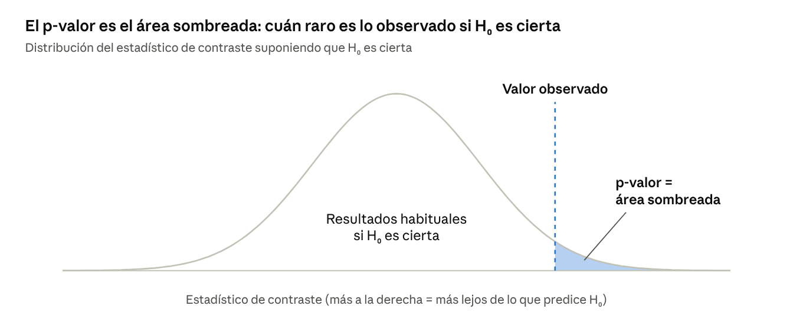
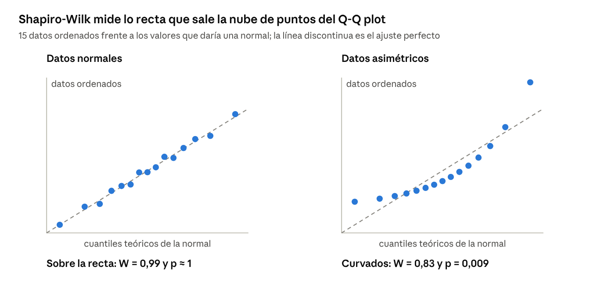
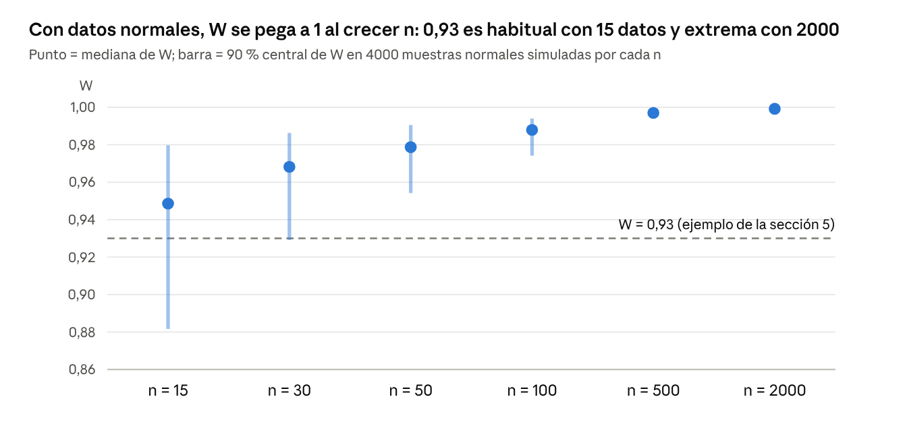

# Anexo: el p-valor y el test de Shapiro-Wilk

*Anexo al Bloque 2 (UD2): complementa las sesiones [B2_S1 · Distribuciones y forma](B2_S1_Distribuciones_y_Forma.ipynb) y [B2_S2 · Normalidad y transformaciones](B2_S2_Normalidad_y_Transformaciones.ipynb).*

## 1. Qué es un contraste de hipótesis

Un contraste de hipótesis comprueba si los datos son compatibles con una afirmación de partida. Funciona como un juicio: se presume la inocencia y solo se condena si las pruebas son muy fuertes.

- **Hipótesis nula (H₀):** la postura por defecto. Por ejemplo, "las medias son iguales" o "los datos son normales".
- **Hipótesis alternativa (H₁):** lo contrario. Por ejemplo, "las medias son distintas" o "los datos no son normales".
- **Estadístico de contraste:** un número calculado con la muestra que mide cuánto se alejan los datos de lo que predice H₀.

El test no demuestra nada al 100 %. Solo dice si los datos serían raros en el caso de que H₀ fuera cierta.

## 2. El p-valor

El **p-valor** es la probabilidad de obtener un resultado tan extremo como el observado, o más, **suponiendo que H₀ es cierta**.



Si H₀ fuera cierta, el estadístico caería casi siempre en la zona central. Cuanto más lejos cae el valor observado, más pequeña es el área de la cola y menor el p-valor.

- **p pequeño:** lo observado sería muy raro si H₀ fuera cierta. Eso pone en duda H₀.
- **p grande:** lo observado es perfectamente plausible con H₀. No hay motivo para descartarla.

## 3. Cómo decidir con el p-valor

Se fija de antemano un **nivel de significación α**, normalmente 0,05, y se compara con el p-valor.

| Resultado | Decisión | Cómo se dice correctamente |
| --- | --- | --- |
| p < α | Se rechaza H₀ | "Hay evidencia contra H₀" |
| p ≥ α | No se rechaza H₀ | "No hay evidencia suficiente contra H₀" |

**Errores frecuentes de interpretación:**

- **Falso:** "El p-valor es la probabilidad de que H₀ sea cierta". **Correcto:** es la probabilidad de obtener datos así de extremos *suponiendo* que H₀ es cierta.
- **Falso:** "Como p > 0,05, H₀ es cierta". **Correcto:** no rechazar no es demostrar; puede que simplemente haya pocos datos.
- **Falso:** "Un p-valor muy pequeño significa un efecto muy grande". **Correcto:** con muchos datos, diferencias minúsculas dan p-valores minúsculos.
- **Falso:** "p = 0,049 y p = 0,051 son conclusiones opuestas". **Correcto:** son prácticamente la misma evidencia; α es solo un umbral convencional.

## 4. El test de Shapiro-Wilk

Shapiro-Wilk comprueba si una muestra puede proceder de una distribución normal.

- **H₀:** los datos proceden de una distribución normal.
- **H₁:** los datos no proceden de una distribución normal.
- **Estadístico W:** está entre 0 y 1. Compara los datos ordenados con los valores que cabría esperar de una normal, igual que un Q-Q plot.



*Ejemplo calculado con scipy · n = 15 en cada panel.*

Cuanto más se alinean los puntos con la recta, más se acerca W a 1. Por eso aquí lo "extremo" es una **W pequeña**, y el p-valor es la probabilidad de obtener una W igual o menor que la observada si los datos fueran realmente normales.

## 5. Shapiro-Wilk en Python

En `scipy` el test devuelve dos valores: el estadístico W y el p-valor.

```python
import numpy as np
from scipy import stats

x = np.random.normal(loc=50, scale=10, size=15)   # muestra de ejemplo

w, p = stats.shapiro(x)
print(f"W = {w:.3f}, p-valor = {p:.3f}")

alpha = 0.05
if p < alpha:
    print("Se rechaza H0: hay evidencia de que los datos NO son normales")
else:
    print("No se rechaza H0: no hay evidencia contra la normalidad")
```

**Ejemplo de lectura.** Con 15 datos sale W = 0,93 y p = 0,30. Como 0,30 > 0,05, no se rechaza la normalidad y podemos trabajar asumiéndola, por ejemplo para no transformar la variable. Pero no hemos *demostrado* que los datos sean normales: con 15 datos el test tiene poca potencia.

Acompaña siempre el test de un gráfico:

```python
import matplotlib.pyplot as plt
stats.probplot(x, dist="norm", plot=plt)   # Q-Q plot
plt.show()
```

## 6. El tamaño muestral importa

Una misma W no significa lo mismo con 15 datos que con 2000. Por eso hay que decidir con el p-valor, que ya tiene en cuenta n, y no con la W "a ojo".



*Simulación con `scipy.stats.shapiro` · 4000 muestras normales por cada n.*

Con 15 datos normales, una W de 0,93 cae dentro de lo habitual (p ≈ 0,30). Con 2000 datos normales, W casi nunca baja de 0,998, así que 0,93 sería un valor extremo y el p-valor saldría prácticamente 0.

- **n pequeño:** el test tiene poca potencia y casi nunca rechaza, aunque los datos no sean normales.
- **n grande:** rechaza por desviaciones mínimas que no importan en la práctica.
- **En ambos casos:** mira también el Q-Q plot antes de decidir.

## 7. Resumen

| Concepto | Idea clave |
| --- | --- |
| H₀ en Shapiro-Wilk | Los datos proceden de una distribución normal |
| Estadístico W | Entre 0 y 1; mide lo recto que sale el Q-Q plot |
| "Extremo" | Una W pequeña, lejos de lo típico para ese n |
| p-valor | Probabilidad de una W igual o menor que la observada si los datos fueran normales |
| p < 0,05 | Se rechaza la normalidad |
| p ≥ 0,05 | No hay evidencia contra la normalidad (no la demuestra) |
| n pequeño | Poca potencia: casi nunca rechaza |
| n grande | Rechaza por desviaciones mínimas: mirar también el Q-Q plot |

## 8. Ejercicios de comprobación

1. Un test da p = 0,003 con α = 0,05. ¿Se rechaza H₀? Escribe la conclusión con la frase correcta.
2. Un compañero dice: "p = 0,40, así que hay un 40 % de probabilidad de que H₀ sea cierta". ¿Qué está mal?
3. Shapiro-Wilk con n = 15 da W = 0,93 y p = 0,30. ¿Qué concluyes? ¿Qué *no* puedes afirmar?
4. Con la **misma** W = 0,93 pero n = 2000, ¿esperas un p-valor mayor o menor que 0,30? ¿Por qué?
5. Tienes 5000 datos, Shapiro-Wilk da p = 0,01 y el Q-Q plot es casi una recta. ¿Qué harías?

<details>
<summary><strong>Soluciones</strong></summary>

1. Sí, porque 0,003 < 0,05: "hay evidencia contra H₀".
2. El p-valor no es la probabilidad de H₀. Es la probabilidad de obtener datos así de extremos suponiendo que H₀ es cierta.
3. No se rechaza la normalidad y se puede trabajar asumiéndola. No se puede afirmar que los datos *sean* normales: con 15 datos el test tiene poca potencia.
4. Muchísimo menor, prácticamente 0. Con n = 2000 y datos normales, W ronda 0,999, así que 0,93 sería un valor extremo.
5. Con tantos datos el test detecta desviaciones irrelevantes. Si el Q-Q plot es casi recto, la normalidad suele ser una aproximación aceptable en la práctica.

</details>
